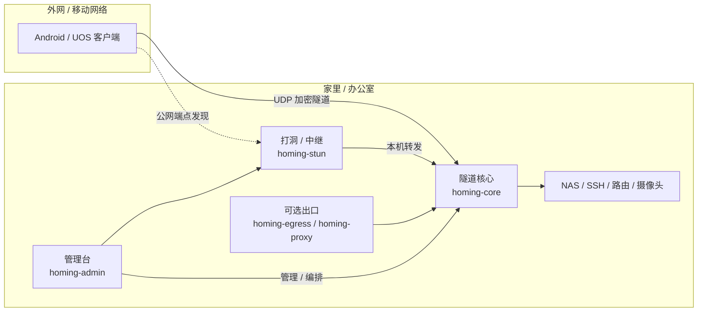

# 归途 Homing

自托管的双栈回连网关：人在外面，打开客户端就像回到家里的网络——访问 NAS、SSH、远程桌面、路由器、摄像头。

服务端全部用 Docker 部署，不依赖任何第三方 VPN 面板；自带管理台、打洞 / 中继、Android 与 UOS/Linux 桌面客户端。

> 仅用于你本人拥有或获得授权的网络；请遵守当地法律与所在组织的安全策略。

## 特性

- **没有公网 IP 也能用**：内置打洞 / 中继，自动发现公网 UDP 端点，支持 UPnP 和端点变化通知。
- **IPv4 + IPv6 双栈**：IPv4 走 NAT 出站，IPv6 直连；客户端可选「只回内网」或「全流量」。
- **一个镜像、host 网络**：隧道核心、打洞、管理台共用一个镜像；宿主机能看到真实客户端源地址，才能做按设备策略。
- **管理台开箱即用**：账户登录 + TOTP 二次验证、设备与密钥管理、连接方式、DNS 公告板、探针参数、出口配置。
- **客户端自动跟随**：端点热切换、健康探针、断线软恢复；支持扫码 / 文件导入、多配置切换。
- **可选代理出口**：按客户端把 IPv4 流量送到本机 TUN 或远端 HTTP/SOCKS5 代理，IPv6 始终直连；支持「管理员授权 + 用户自助开关」。

## 架构



| 组件 | 作用 |
| --- | --- |
| **homing-core** | 隧道核心：内核隧道接口 + IPv4 MASQUERADE / IPv6 NAT66 + 客户端管理 API |
| **homing-stun** | 打洞 / 中继：没有公网 IP 时发现公网 UDP 端点，支持 UPnP、端点变化通知、DNS 公告板 |
| **homing-admin** | 管理台：栈状态、客户端管理、探测参数、连接方式 / 优先级、DNS 公告板、出口配置，自带登录与 TOTP |
| **客户端** | Android 与 UOS/Linux 桌面，支持扫码 / 配置导入、端点自动跟随 |
| **出口（可选）** | 按客户端把 IPv4 流量策略路由到本机 TUN，或经本机透明代理转给远端代理端口 |

### 端口

| 端口 | 协议 | 监听 | 用途 |
| --- | --- | --- | --- |
| `51820` | UDP | 全部网卡 | 隧道入口（公网 / 局域网） |
| `51821` | TCP | `127.0.0.1` | 核心本地 API，仅管理台调用 |
| `51822` | TCP | `ADMIN_LISTEN` | 管理台，只在内网 / 隧道内访问 |
| `51824` | UDP | `10.8.0.1` | 隧道内探针回显 |
| `51830` | UDP | 全部网卡 | 打洞 / 中继入口 |
| `51831` | TCP | `127.0.0.1` | 打洞状态接口 |
| `18081` | TCP | 全部网卡 | 打洞公网自检页 |

## 设计思路（开发思路）

**1. 数据面和控制面分开进程，但共享一个镜像。**
隧道核心、打洞、管理台是三个进程，通过本地 HTTP API 和配置文件协作：管理台挂了不影响已建立的隧道，隧道核心重启也不需要重新配置管理台。一个镜像用 `command` 切换角色，发布、升级、回滚都只涉及一个产物。

**2. 服务端统一 host 网络。**
按客户端做策略路由必须看到真实源地址（`10.8.0.x`），容器网络会把源地址 NAT 成网桥地址，分不出是谁。host 网络还让打洞进程直接拿到公网映射、让出口规则直接写在宿主机命名空间。代价是核心容器需要 `privileged` 写宿主机 `/proc/sys` 和 iptables——这是有意的取舍，部署文档里明确说明。

**3. 没有公网 IP 时，自己解决端点发现问题。**
打洞进程监听一个 UDP 端口，把公网映射地址通过隧道内 API 交给管理台，再下发给客户端；同时支持 UPnP、中继转发和端点变化通知。客户端拿到的是"当前可用端点"，不是写死的 IP，所以宽带重播、手机切网后能自动恢复。

**4. 数据面尽量交给内核，控制面只做编排。**
隧道数据走内核接口，转发 / NAT / 策略路由用 iptables + ip rule 完成，Go 进程只负责配置、状态和健康检查。这样吞吐不受用户态转发影响，进程崩溃也不会把已有连接全部打断。

**5. 按客户端分流的规则是"白名单"。**
默认所有客户端直连家里网络；只有管理员显式打开「代理出口」的设备才会被 `ip rule` 导入出口表。出口表里再排除隧道网段和局域网网段，避免把"回家"的流量又送进代理。IPv6 不参与出口，始终直连。

**6. 权限留在管理员手里，体验交给用户。**
出口有全局总开关、单客户端开关和「自助」授权三层：管理员可以随时关掉某个设备；打开自助后，用户才能在客户端里自己切换这次是否走代理。这样既不用每次找管理员，也不会失控。

**7. 客户端把"恢复"当成一等公民。**
端点定期刷新、握手失败分级重试、探针异常时软恢复而不是直接断开；配置里保存多个候选端点和优先级，网络变化时按顺序尝试。弱网 / 切网场景下比"连不上就报错"更实用。

## 目录结构

```text
server/
  homing-core/      隧道核心（Go）
  stun-gateway/     打洞 / 中继（Go）
  gateway-admin/    管理台与出口编排（Go，内嵌前端页面）
  docker/           容器入口、策略路由脚本
client-android/     Android 客户端（Kotlin）
client-uos/         UOS / Linux 桌面客户端（Python Gtk3 + Go helper）
scripts/            镜像构建 / 发布脚本
docker-compose.yml  服务端编排
```

## 快速开始

### 前置条件

- Linux 宿主机，内核 ≥ 5.6，已启用 UDP 隧道支持；
- Docker + Docker Compose v2；
- 一个外网可达的 UDP 端口（有公网 IP 时做端口映射；没有公网 IP 时用内置打洞）；
- root 或 docker 权限。

### 部署

```bash
git clone https://github.com/gjl6/homing-vpn.git /opt/homing
cd /opt/homing
cp .env.example .env
vi .env          # 至少修改 CORE_DNS、CORE_LAN、ADMIN_PASSWORD、VPN_HOST_DIR

docker compose build
docker compose up -d
```

> 管理台需要挂载 `docker.sock` 来在线重建容器；`VPN_HOST_DIR` 必须等于 compose 所在目录。
> 构建时会额外拉取一个代理内核基础镜像（仅用于可选的远程代理出口），离线环境可先 `docker pull` 或用 `--build-arg` 指定。
> 如果构建时访问不了 `proxy.golang.org`（国内网络常见），在 `.env` 加一行 `GO_PROXY=https://goproxy.cn,direct` 再构建。

首次启动后：

1. 浏览器打开 `http://<宿主机局域网 IP>:51822`，用 `.env` 里的 `ADMIN_PASSWORD` 登录（首次启动自动创建管理员）；
2. 立刻修改密码并开启 TOTP；
3. 在「客户端」里新建设备，扫码或下载配置；
4. 路由器 / 云安全组放行 **UDP `${CORE_PORT}`**（默认 51820），**不要**把 51822 映射到公网。

### 防火墙

- 放行：`UDP 51820`（隧道）、`UDP 51830`（打洞，启用时）；
- 仅内网：`TCP 51822`（管理台）、`TCP 18081`（自检页，可选）；
- 不要暴露：`51821` / `51831`（只监听本机）。

## 配置项（.env）

| 变量 | 说明 | 示例 |
| --- | --- | --- |
| `HOMING_IMAGE_PREFIX` | 镜像仓库前缀；本地构建留空 | `yourname/` |
| `HOMING_VERSION` | 镜像 tag，同时写入 OCI label | `1.0.0` |
| `CORE_PORT` | 隧道 / 打洞目标 / IPv6 直连统一 UDP 端口 | `51820` |
| `PROBE_PORT` | 隧道内探针回显端口 | `51824` |
| `CORE_DNS` | 下发给客户端的 DNS | `192.168.1.1` |
| `CORE_LAN` | 家里局域网网段（「只回内网」客户端用） | `192.168.1.0/24` |
| `CLIENT_NET` | 隧道内客户端网段 | `10.8.0.0/24` |
| `ADMIN_PASSWORD` | 首次启动初始化管理员；之后以管理台账户 / TOTP 为准 | 至少 16 位 |
| `ADMIN_LISTEN` | 管理台监听地址 | `:51822` |
| `VPN_HOST_DIR` | 项目绝对路径（管理台重建容器时用，必须与 compose 同目录） | `/opt/homing` |

## 客户端

### 客户端配置

管理台新建客户端后会生成一份「归途 JSON」配置，包含端点、设备密钥、DNS、分流模式和公告板参数。客户端通过扫码、相册识别、文件导入或粘贴 JSON 导入，支持保存多份配置并切换。

### Android

- 需要 JDK 17、Android SDK 34；
- 扫码使用 ZXing，相机权限运行时申请；
- 支持前台服务常驻、开机自启、端点自动跟随和代理出口自助开关。

```bash
cd client-android
./gradlew :app:assembleDebug        # app/build/outputs/apk/debug/app-debug.apk
```

正式包使用本地签名配置（不要提交密钥）：

```bash
cp keystore.properties.example keystore.properties
vi keystore.properties               # storeFile / storePassword / keyAlias / keyPassword
./gradlew :app:assembleRelease
```

### UOS / Linux 桌面

- Gtk3 界面 + 特权 helper（polkit 授权），helper 负责建隧道、写路由和 DNS；
- 支持两种后端：内核隧道优先，不可用时自动降级到用户态；
- 打包为 `.deb`，同时提供 amd64 / arm64。

```bash
cd client-uos
mkdir -p dist
CGO_ENABLED=0 GOOS=linux GOARCH=amd64 go build -trimpath -ldflags "-s -w" -o dist/homing-helper-amd64 ./cmd/homing-helper
CGO_ENABLED=0 GOOS=linux GOARCH=arm64 go build -trimpath -ldflags "-s -w" -o dist/homing-helper-arm64 ./cmd/homing-helper
VERSION=2.1.0 bash packaging/build-deb.sh
sudo dpkg -i dist/homing-client_2.1.0_amd64.deb
```

安装后从应用菜单打开「归途」，或执行 `homing-gui`；命令行入口是 `homing`。

## 可选：代理出口

默认 VPN 流量从家里宽带直连。需要让部分设备走代理时：

1. 「客户端」页逐台打开「代理出口」，决定哪些设备走代理；
2. 「出口」页打开总开关并选择模式：
   - **本机 TUN**：宿主机已经有一个 TUN 代理，把开启出口的客户端 IPv4 流量策略路由进去；
   - **远程代理**：代理在另一台主机，网关在本机起一个透明代理，把连接转给远端 HTTP/SOCKS5 端口。
3. 如果希望用户在客户端里自己开关，再打开该客户端的「自助」开关。

行为约定：

- 管理台切换后约 10 秒生效，不需要重连客户端；
- 全局出口关闭时，客户端提示"管理员未开启全局出口"；自助关闭时提示"管理员未开启代理自助权限"；
- **IPv6 始终直连**（出口只处理 IPv4）；客户端配置不用改。

## 运维

```bash
docker compose ps
docker compose logs -f --tail=100 homing-core
docker compose pull && docker compose up -d          # 升级
curl -s http://127.0.0.1:51822/healthz               # 管理台健康
curl -s http://127.0.0.1:51831/healthz               # 打洞健康
```

需要备份的数据：

| 路径 | 内容 |
| --- | --- |
| `core-data/core.json` | 服务端私钥、客户端密钥（0600） |
| `stun-data/admin.json` | 管理员账户、TOTP（0600） |
| `stun-data/*.json` | 打洞 / 连接方式 / 探针 / 出口配置 |
| `stun-data/proxy/` | 远程代理模式的运行配置（含远端代理密码） |
| `.env` | 部署参数 |

```bash
tar czf homing-backup-$(date +%F).tgz core-data stun-data .env docker-compose.yml
```

这些目录已加入 `.gitignore`，不要提交到任何仓库。

## 安全建议

- 管理台只在内网或隧道内访问，**不要把 51822 暴露到公网**；远程管理先连隧道，再访问 `http://10.8.0.1:51822`。
- 每台设备独立密钥；设备丢失立即在管理台停用或删除。
- `core-data/`、`stun-data/`、`.env`、客户端签名密钥都不要进 git。
- 发现安全问题请私下联系维护者，不要公开 Issue。

## 开发

- 服务端：Go 1.22+，每个组件独立 `go.mod`；
- 管理台前端是内嵌在 `gateway-admin/ui.html` 的单文件页面；
- Android：Kotlin + Gradle，`compileSdk 34` / `minSdk 24`；
- UOS：Python 3 + Gtk3，helper 用 Go 静态编译。

```bash
# 服务端各组件
cd server/homing-core   && go build ./... && go test ./...
cd server/gateway-admin && go build ./... && go test ./...
cd server/stun-gateway  && go build ./...

# 客户端 helper
cd client-uos && go build ./... && go test ./...
```

## 许可证

本项目采用 **GPL-2.0-only** 许可协议，完整文本见 [`LICENSE`](LICENSE)。
